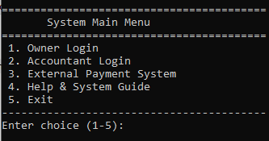
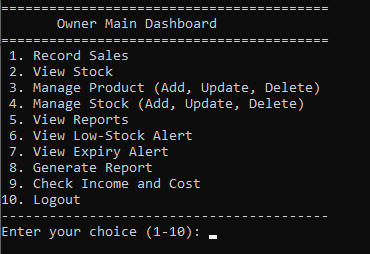
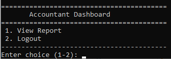
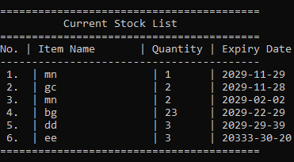
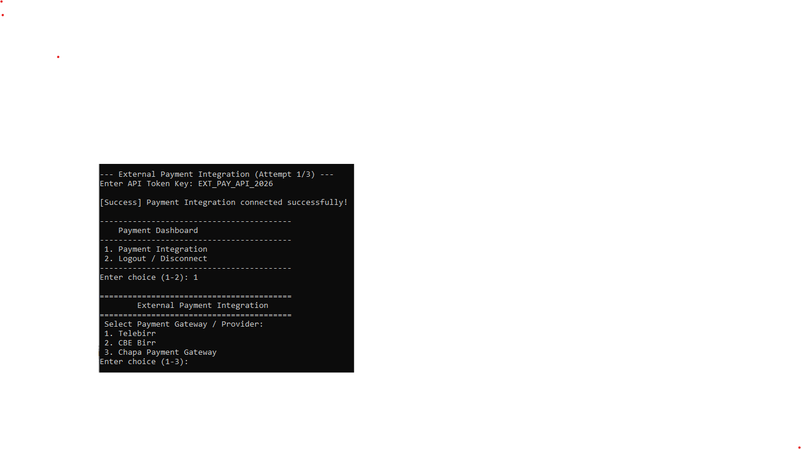
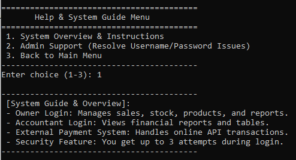
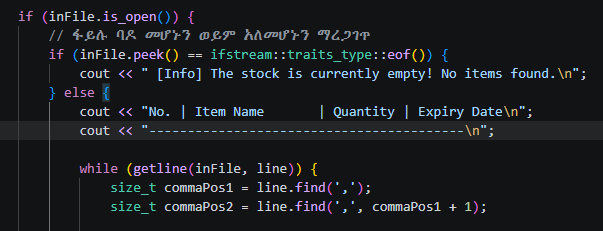

# Mini-Market Stock Management System

A console-based Stock Management System developed in C++ for *Kidemu Mini Market* as a university software engineering project at Wachemo University, Department of Software Engineering.

The project was developed as part of the following courses:

- Fundamentals of Software Engineering
- Fundamentals of Database
- Computer Programming in C++

## 📌 Overview

Kidemu Mini Market previously managed product information, stock, sales, and expiry dates manually using notebooks. This made record keeping time-consuming and increased the possibility of errors.

The Mini-Market Stock Management System was designed to computerize these activities through a menu-driven C++ application.

The system provides functionality for:

- Product management
- Stock management
- Sales recording
- Automatic stock quantity updates
- Low-stock alerts
- Near-expiry product alerts
- Income and cost tracking
- Report generation
- Role-based access
- Simulated payment processing
- Built-in help and system guidance

### Database Component

The project demonstrates both C++ file handling and relational database concepts. The C++ application uses local text files for operational data persistence, while the included database.sql file provides a separate SQL Server database component developed as part of the database course.

The SQL Server component demonstrates:
- Relational database design
- Table relationships
- Database normalization (1NF–3NF)
- Sample data
- Practical SQL queries

> Note: The C++ application and SQL Server database are separate components of this academic project. The current C++ application does not directly connect to the SQL Server database. The database.sql file is included to demonstrate the database design and SQL concepts learned as part of the database component.

## ✨ Features

### 🔐 Authentication & User Roles

- User login and authentication
- Role-based access
- Separate dashboards for different user roles
- Owner and Accountant functionality

### 📦 Product Management

- Add products
- View products
- Search products
- Update product information
- Delete products

### 📊 Stock Management

- Add stock records
- View stock information
- Update stock records
- Delete stock records
- Automatically update stock quantities after sales

### 🧾 Sales Management

- Record sales
- Calculate sales amounts
- Automatically reduce available stock
- Store sales information for reporting

### ⚠️ Alerts

- Low-stock alerts
- Near-expiry product alerts
- Helps users identify products that require attention

### 💰 Financial Management

- Track income
- Track costs
- Calculate estimated profit
- Generate financial reports

### 💳 Payment Simulation

The application includes simulated payment options for:

- Telebirr
- CBE Birr
- Chapa

These are implemented as part of the project simulation and are not connected to live payment services.

### 📈 Reports

- Sales reports
- Income reports
- Cost reports
- Estimated profit
- Stock-related information

### 📖 Help & System Guide

- Built-in help functionality
- System usage guidance for users

## 🏗️ System Design

The system was analyzed and designed using standard software engineering and UML modeling techniques.

The project documentation includes:

- Use Case Diagrams                  - Sequence Diagrams
- Activity Diagrams                  - State Chart Diagrams
- Class Diagrams                     - Entity-Relationship (ER) Diagram
- Database Design                    - Database Normalization (1NF–3NF)
- System Architecture                - Requirement Analysis
- Feasibility Analysis               - Problem Statement

The complete documentation is available in the docs/ directory.

## 🛠️ Technology Stack

| Component                         | Technology            |
|-----------------------------------|-----------------------|
| Programming Language              | C++                   |
| Data Persistence                  | Local Text Files      |
| Database Design                   | Microsoft SQL Server  |
| IDE / Development Environment     | Code::Blocks          |
| UML Modeling                      | Enterprise Architect  |
| Operating System                  | Windows               |

## 📂 Project Structure

mini-market-stock-management-system/
- README.md
- LICENSE
- .gitignore
- src/
    - main.cpp
- database/
    - setup/
        - 01_create_database.sql
        - 02_create_tables.sql
        - 02_seed_sample_data.sql
    - queries/
        - 01_select_queries.sql
    - practice/
        - 01_data_modification.sql
- docs/
    - Client-Interview-Form.pdf
    - Project-Documentation.pdf
- images/
    - screenshots/
        - accountant-main-menu.png
        - code-sample.png
        - external-payment-system-main-menu.png
        - help-menu.png
        - login.png
        - owner-main-menu.png
        - sample-stock.png

## ⚙️ Getting Started

### Prerequisites

- A C++ compiler such as G++ / MinGW
- Code::Blocks or another C++ development environment
- Windows operating system
- SQL Server and SQL Server Management Studio (SSMS) only for running the included SQL script

### Setup

1. Clone the repository:
  
   git clone https://github.com/minasemengesha/mini-market-stock-management-system.git
   cd mini-market-stock-management-system
   
2. Open main.cpp in Code::Blocks or another C++ development environment.

3. Build and run the application.

### Compile Using G++

g++ main.cpp -o stock_management
Run the application:

stock_management
The application uses local text files for application data persistence.

### 🗄️ SQL Server Database

The project also includes a separate SQL Server database script:

`database.sql`
To run the database script:

1. Open SQL Server Management Studio (SSMS).
2. Open database.sql.
3. Execute the script.
4. The script creates the Stock_Management_System database and its related tables.

The SQL script includes:

- Database and table creation   - Primary and foreign keys    - Sample data
- INSERT                        - UPDATE                      - DELETE
- SELECT                        - LIKE                        - BETWEEN
- IN                            - IS NULL                     - EXISTS
- ALL and etc..

> Important: The SQL Server database is included as the database design and practical component of the project. The current C++ application does not directly connect to SQL Server.

## 👥 User Roles

| Role         | Permissions                                               |
|--------------|-----------------------------------------------------------|
| Owner        | Add, update, and delete products and stock, record sales,    view stock, and access reports                                             |
| Accountant   | Manage and view income and cost information and access financial reports                                                          |

The system provides different functionality according to the authenticated user's role.

## 📄 Documentation

The complete project documentation — including problem statement, feasibility analysis, requirement analysis, database design, database normalization, UML diagrams, system architecture, and system design — is available in the docs folder.

### Project Documents

- [Client Interview Form](docs/Client-Interview-Form.pdf)
- [Project Documentation](docs/Project-Documentation.pdf)

## 📸 Screenshots

### 🔐 Login

### 👤 Owner Main Menu

### 👨‍💼 Accountant Main Menu

### 📦 Sample Stock

### 💳 External Payment System

### 📖 Help Menu

### 💻 Code Sample

## 👨‍💻 Contributors

- Minase Mengesha
- Ruhama Alemu
- Fetiha Oumer
- Eyobed Solomon
- Yamilaksira Ashenafi

*Department of Software Engineering, College of Engineering and Technology, Wachemo University*

## 🎓 Academic Project

This project demonstrates the practical application of concepts learned in:

- Software Engineering
- Database Systems
- C++ Programming
- Requirements Analysis
- System Analysis and Design
- UML Modeling
- Database Design
- Database Normalization

## 📜 License

This project is licensed under the MIT License — see the [LICENSE](LICENSE) file for details.
